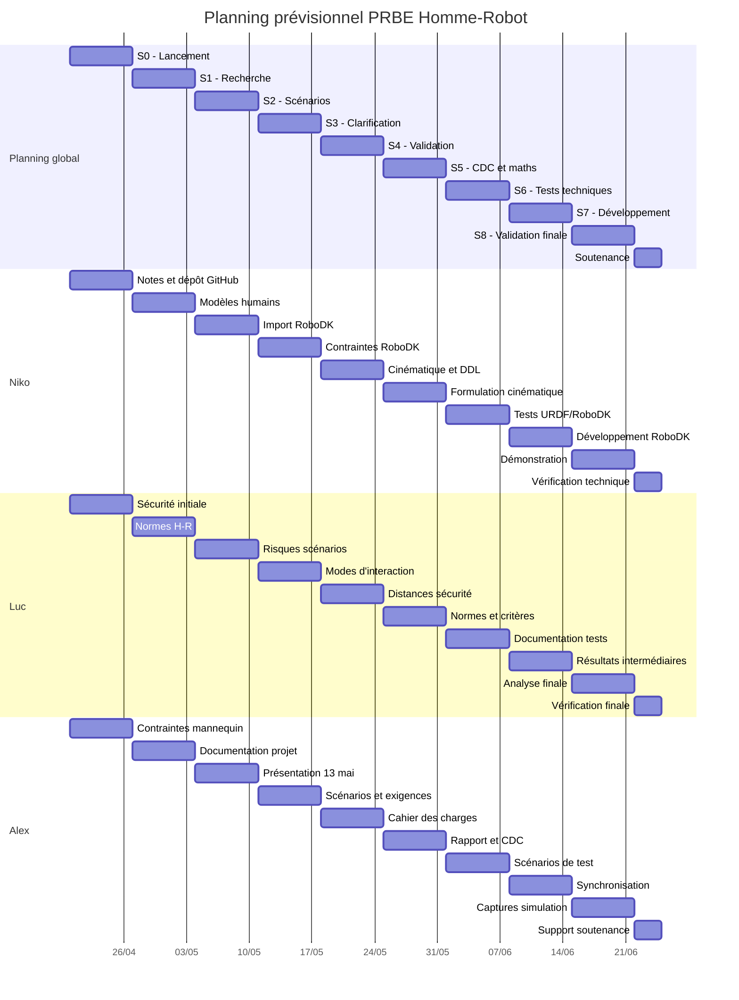

# Cahier des charges - PRBE Homme-Robot

**Projet :** Simulation du mouvement humain et interaction homme-robot dans RoboDK

**Contexte :** PRBE 2026 - ISAE-Supméca - Ligne ALIX

**Équipe :** Niko Khachidze, Luc Fantasia, Alexandre Nowak

**Encadrants :** Francesco Ciampi, Thierno Diallo

**Période :** avril 2026 - juin 2026

## 1. Contexte et objectif du projet

Le projet porte sur la simulation d'interactions entre un opérateur humain et un robot mobile/manipulateur dans l'environnement RoboDK, en s'appuyant sur la ligne ALIX de l'ISAE-Supméca.

L'objectif principal est de représenter un humain dans RoboDK, puis de simuler des scénarios d'interaction homme-robot permettant d'évaluer les conditions de sécurité et d'organisation du travail.

Le verrou technique principal est l'intégration d'un modèle humain exploitable dans un environnement de simulation robotique. RoboDK permet de simuler des robots industriels, mais ne propose pas directement de modèle humain cinématique adapté au pilotage articulaire. Le projet vise donc à construire un pont entre un mannequin humain au format URDF et une simulation RoboDK.

## 2. Périmètre du projet

### 2.1. Périmètre fonctionnel

Le projet se concentre sur deux scénarios :

- **Scénario 1 - Coexistence :** l'humain et le robot partagent un même environnement, mais ne travaillent pas sur une même tâche.
- **Scénario 2 - Synchronisation :** le robot et l'humain interviennent dans un même processus de production, avec une coordination temporelle indirecte.

Les modes de coopération et de collaboration directe ne font pas partie du périmètre principal de la démonstration finale. Ils peuvent être mentionnés comme perspectives.

### 2.2. Périmètre technique

Le projet utilise :

- **RoboDK** pour la simulation robotique.
- **Python** pour le pilotage.
- **URDF** pour la description du mannequin humain.
- **Human Model Generator (HMG)** pour générer un mannequin anthropométrique.
- Les données disponibles de la plateforme **ALIX** et du robot **AMR Mir100**.

Le mannequin humain sera d'abord simplifié pour garantir une intégration réaliste dans RoboDK.

### 2.3. Hors périmètre

Les éléments suivants ne sont pas visés dans la version principale du projet :

- Contact physique direct entre l'humain et le robot.
- Simulation biomécanique complète du corps humain.
- Capture de mouvement en temps réel par caméra.
- Contrôle dynamique complet de l'équilibre humain.

Ces points pourront être présentés comme limites ou perspectives.

## 3. Scénarios retenus

### 3.1. Scénario 1 - Coexistence

#### 3.1.1. Description

Dans ce scénario, l'humain et le robot évoluent dans un même environnement de travail, mais n'ont pas d'interaction directe ou indirecte sur une pièce commune. Le robot suit sa trajectoire, tandis que l'opérateur peut être présent dans l'espace.

L'objectif est d'assurer que le robot adapte son comportement en fonction de la présence humaine afin d'éviter tout contact.

#### 3.1.2. Règles de fonctionnement

- Si un humain est détecté à moins de **1 m**, le robot ralentit.
- Si un humain est détecté à moins de **0,5 m**, le robot s'arrête complètement.
- Si un humain bloque un passage de porte pendant **30 secondes**, le robot recule pour lui laisser le passage.
- Si l'humain se déplace et libère la zone, le robot reprend son trajet.
- En espace ouvert, le robot s'arrête et attend que l'humain sorte de la zone critique.

#### 3.1.3. Exigences fonctionnelles

| ID | Exigence | Priorité |
|---|---|---|
| COEX-F1 | Détecter la présence d'un humain dans la zone de déplacement du robot | Haute |
| COEX-F2 | Ralentir le robot lorsque la distance humain-robot devient inférieure à 1 m | Haute |
| COEX-F3 | Arrêter le robot lorsque la distance humain-robot devient inférieure à 0,5 m | Haute |
| COEX-F4 | Gérer le cas d'un humain immobile devant une porte pendant 30 s | Moyenne |
| COEX-F5 | Reprendre automatiquement le trajet lorsque la zone redevient libre | Moyenne |

#### 3.1.4. Critères de validation

- La simulation montre visuellement les zones de ralentissement et d'arrêt.
- Le comportement du robot change lorsque l'humain entre dans les zones critiques.
- Le cas de blocage d'une porte ne doit pas conduire à l'arrêt de l'humain et du robot sans fin.

### 3.2. Scénario 2 - Synchronisation

#### 3.2.1. Description

Dans ce scénario, le robot et l'opérateur participent à un même processus industriel, mais sans contact direct. Le robot dépose une pièce dans une zone de transfert, puis l'opérateur vient récupérer cette pièce dans une fenêtre de temps donnée.

L'objectif est de montrer une vraie synchronisation temporelle entre le robot et l'opérateur : le robot doit libérer la zone avant l'arrivée de l'humain, et l'humain doit récupérer la pièce dans le délai prévu sans entrer en conflit avec le mouvement du robot.

#### 3.2.2. Workflow retenu

1. Le robot prélève une pièce au stock.
2. Le robot transporte la pièce vers la zone de transfert.
3. Le robot dépose la pièce dans la zone de transfert pendant un intervalle autorisé.
4. Le robot quitte la zone de transfert ou se place dans une position d'attente non gênante.
5. L'opérateur récupère la pièce dans la fenêtre de temps définie.
6. Les règles de sécurité du scénario de coexistence restent actives pendant toute la séquence.

#### 3.2.3. Règles de fonctionnement

- Une seule pièce est prise en compte dans la zone de transfert pour chaque cycle.
- La récupération par l'opérateur doit se faire dans une fenêtre temporelle définie après le dépôt de la pièce.
- Le robot et l'opérateur ne doivent pas occuper simultanément la zone de transfert.
- Si l'opérateur arrive trop tôt ou si le robot tarde à quitter la zone, les règles de ralentissement et d'arrêt s'appliquent.
- Le robot doit attendre dans une position non gênante lorsque la fenêtre de transfert n'est pas disponible.

#### 3.2.4. Exigences fonctionnelles

| ID | Exigence | Priorité |
|---|---|---|
| SYNC-F1 | Représenter une zone de stock, une zone de transfert et une zone opérateur | Haute |
| SYNC-F2 | Modéliser l'état de la zone de transfert : libre, occupée par le robot, pièce disponible, occupée par l'opérateur | Haute |
| SYNC-F3 | Définir une fenêtre temporelle de récupération de la pièce par l'opérateur | Haute |
| SYNC-F4 | Empêcher l'occupation simultanée de la zone de transfert par le robot et l'opérateur | Haute |
| SYNC-F5 | Appliquer les règles de sécurité de coexistence pendant le dépôt et la récupération | Haute |
| SYNC-F6 | Montrer une coordination temporelle entre dépôt robot et récupération humaine | Moyenne |

#### 3.2.5. Critères de validation

- La simulation montre un cycle complet stock -> zone de transfert -> récupération opérateur.
- L'opérateur récupère la pièce dans la fenêtre temporelle prévue.
- Le robot et l'opérateur ne se trouvent pas simultanément dans la zone de transfert.
- La sécurité reste prioritaire sur la synchronisation.

## 4. Modèle humain

### 4.1. Objectif du modèle humain

Le modèle humain doit permettre de représenter un opérateur dans RoboDK avec un niveau de détail suffisant pour visualiser les interactions et les distances de sécurité.

Le projet ne vise pas une simulation biomécanique exhaustive. Le modèle doit rester simple, pilotable et exploitable.

Des simulations sur différentes morphologies et corpulences pourront être réalisées afin de mieux valider le modèle, notamment vis-à-vis des distances de sécurité et de la robustesse des scénarios.

### 4.2. Choix de modélisation

Le mannequin est généré à partir de HMG sous forme d'un fichier URDF.

Pour la démonstration technique, les choix actuels sont :

- Utiliser un mannequin anthropométrique scalable.
- Figer le buste pour réduire le nombre de degrés de liberté.

### 4.3. Degrés de liberté utiles

Pour les scénarios retenus :

- Les jambes sont utiles pour représenter le déplacement ou la posture de l'opérateur.
- Les bras sont utiles pour le scénario de synchronisation, lorsque l'opérateur assemble ou récupère des pièces.
- La tête, les doigts et les mouvements internes fins du buste ne sont pas prioritaires.

Les degrés de liberté retenus correspondent uniquement à des rotations articulaires, sans prise en compte des degrés de liberté en déplacement.

| Segment | DDL | Détail |
|---|---:|---|
| Buste -> Cuisse (x2) | 3 par jambe | Mouvements fluides et courbes |
| Cuisse -> Mollet (x2) | 1 par jambe | Flexion genou, type pivot |
| Cheville -> Pied (x2) | 1 par jambe | Pivot cheville |
| **Total jambes** | **10** | 5 DDL par jambe, donc 10 DDL pour les deux jambes |
| Épaule (x2) | 3 par bras | Rotation de l'épaule |
| Coude (x2) | 1 par bras | Flexion du coude |
| Poignet (x2) | 2 par bras | Orientation du poignet |
| **Total bras** | **12** | 6 DDL par bras, donc 12 DDL pour les deux bras |
| **Total retenu** | **22** | Jambes et bras uniquement |

Pour le scénario 1, le mannequin utilise uniquement les membres inférieurs afin de représenter les postures et déplacements de l'opérateur. Pour le scénario 2, le mannequin utilise les membres inférieurs et supérieurs, car l'opérateur doit se déplacer puis récupérer une pièce dans la zone de transfert.

## 5. Sécurité et références normatives

Le projet s'appuie sur les références suivantes :

- **ISO 10218-1** : exigences de sécurité pour les robots industriels, côté fabricant.
- **ISO 10218-2** : exigences de sécurité pour les applications robotisées et l'intégration en cellule.
- **ISO/TS 15066** : spécifications relatives aux opérations collaboratives homme-robot.

Pour les scénarios retenus, le principe principal est la **surveillance de vitesse et de séparation**. Le robot doit adapter sa vitesse ou s'arrêter selon la distance à l'opérateur.

Les distances retenues pour la simulation sont :

| Zone | Distance | Comportement robot |
|---|---:|---|
| Zone normale | > 1 m | Trajet nominal |
| Zone de ralentissement | <= 1 m | Vitesse réduite |
| Zone d'arrêt | <= 0,5 m | Arrêt complet |

## 6. Livrables attendus

### 6.1. Livrables intermédiaires

- Cahier des charges validé.
- Formulation mathématique cinématique du mannequin.
- Import du mannequin humain dans RoboDK.
- Démonstrateur simple du scénario de coexistence.
- Démonstrateur simple du scénario de synchronisation.

### 6.2. Livrables finaux

- Simulation RoboDK des scénarios retenus.
- Scripts Python associés.
- Rapport final.
- Support de soutenance.

## 7. Planning prévisionnel

Le projet a débuté par la réunion de lancement du **20 avril** et se termine par la soutenance prévue le **24 juin**. Le planning ci-dessous représente : chaque période précise les tâches à réaliser, les livrables attendus et la répartition entre les membres du groupe.

| Période | Objectif de la période | Niko | Luc | Alex | Livrable / jalon |
|---|---|---|---|---|---|
| S0 : 20-26 avril | Lancement du projet, compréhension du sujet et identification du besoin : modéliser un mannequin humain cinématique dans RoboDK. | Structurer les notes de lancement et organiser le dépôt GitHub. | Identifier les premières contraintes de sécurité homme-robot. | Identifier les contraintes techniques liées au mannequin et à RoboDK. | Objectifs généraux du projet définis. |
| S1 : 27 avril-3 mai | Recherche préliminaire sur les modèles humains, les approches cinématiques possibles et l'utilisation de Python/RoboDK. | Rechercher des solutions de mannequin humain et de modélisation cinématique. | Rechercher les premières références sur les interactions homme-robot et les normes. | Regrouper les sources et organiser la documentation projet. | Base documentaire initiale. |
| S2 : 4-10 mai | Définition des premiers scénarios homme-robot, premières exigences fonctionnelles et préparation de la présentation du 13 mai. | Étudier les possibilités d'import ou de reconstruction du mannequin dans RoboDK. | Formaliser les premiers scénarios et les premiers risques de sécurité. | Préparer la présentation du 13 mai et structurer les exigences initiales. | Présentation intermédiaire préparée. |
| S3 : 11-17 mai | Présentation intermédiaire, clarification des scénarios, identification des normes de sécurité et des contraintes d'import du mannequin. | Présenter les contraintes RoboDK et préciser les pistes de modélisation. | Présenter les modes d'interaction et les normes à étudier. | Présenter le contexte, les scénarios et les exigences fonctionnelles. | Scénarios et exigences discutés avec les encadrants. |
| S4 : 18-24 mai | Validation des scénarios retenus, choix des DDL utiles, distances de sécurité et structuration du cahier des charges. | Valider l'approche cinématique classique et les DDL utiles du mannequin. | Valider les distances de sécurité et les règles de ralentissement/arrêt. | Intégrer les décisions de réunion dans le cahier des charges et le planning. | Scénarios retenus, DDL et règles de sécurité validés. |
| S5 : 25-31 mai | Finalisation du cahier des charges, formalisation du modèle cinématique et formulation mathématique. | Finaliser le tableau des DDL et formaliser la cinématique du mannequin. | Relier les normes aux scénarios, aux zones de sécurité et aux critères de validation. | Finaliser le cahier des charges et structurer le rapport. | Cahier des charges finalisé et formulation mathématique. |
| S6 : 1-7 juin | Préparation des tests URDF/RoboDK et début du développement technique. | Préparer les tests URDF/RoboDK et vérifier l'exploitation des DDL. | Documenter les premiers tests, les choix techniques et les limites rencontrées. | Préparer les scénarios de test et les attendus de validation. | Protocole de tests et premiers essais techniques. |
| S7 : 8-14 juin | Développement technique : import/adaptation du mannequin, scripts de pilotage et premiers tests de simulation. | Générer ou adapter le mannequin URDF, tester l'import et le pilotage dans RoboDK. | Mettre à jour le rapport avec les résultats intermédiaires et les analyses. | Valider les comportements de ralentissement, arrêt, attente et synchronisation temporelle. | Mannequin exploitable et premiers scripts de simulation. |
| S8 : 15-21 juin | Intégration et validation des scénarios coexistence/synchronisation, captures, résultats et finalisation du fond du rapport. | Implémenter ou ajuster les animations dans RoboDK et stabiliser la démonstration. | Finaliser l'analyse des résultats et la partie validation du rapport. | Vérifier la cohérence des scénarios et préparer les captures de simulation. | Démonstrateurs validés et rapport en version quasi finale. |
| Finalisation : 22-24 juin | Relecture finale, vérifications, répétition, correction des derniers détails, finalisation du support et soutenance du 24 juin. | Vérifier la démonstration technique et préparer les explications associées. | Vérifier la cohérence sécurité/normes et préparer les réponses aux questions. | Finaliser le support de soutenance, coordonner la répétition et les dernières corrections. | Rapport final, support final et soutenance du 24 juin. |

### 7.1. Diagramme de Gantt

## 8. Critères de réussite du projet

Le projet sera considéré réussi si :

- Un mannequin humain est intégré ou représenté de manière exploitable dans RoboDK.
- Les deux scénarios retenus sont clairement formalisés.
- La simulation montre des comportements de sécurité cohérents : ralentissement, arrêt, attente.
- Le scénario de synchronisation illustre une coordination temporelle entre robot et opérateur.
- Les choix techniques sont justifiés par les exigences, les contraintes RoboDK et les normes de sécurité.
