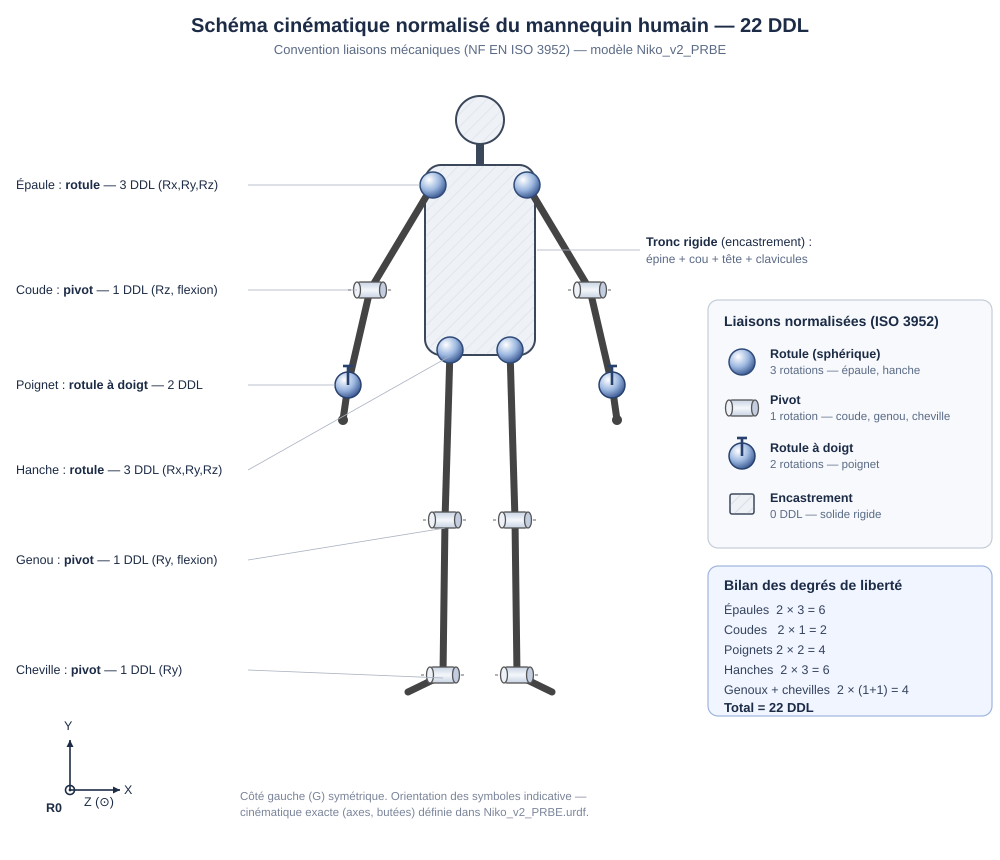

# Formulation cinématique — schéma de liaisons et torseurs

Base formelle de la cinématique du mannequin : le **schéma cinématique normalisé**
et le **torseur cinématique de chaque liaison**.

> **Périmètre (consigne Ciampi, 20 mai 2026).** On *structure et explique* la
> cinématique — on donne une base formelle au modèle. On ne résout pas les équations.

---

## 1. Schéma cinématique normalisé

Chaque articulation est représentée par sa **liaison** normalisée (NF EN ISO 3952) :
la rotule (3 rotations) est **un seul symbole**, pas trois pivots.

| Articulation | Liaison normalisée | DDL |
|---|---|---|
| Épaule, Hanche | **Rotule (sphérique)** | 3 rotations |
| Coude, Genou, Cheville | **Pivot** | 1 rotation |
| Poignet | **Rotule à doigt (sphérique à doigt)** | 2 rotations |
| Épine, cou, tête, clavicules, doigts | **Encastrement** | 0 (solide rigide) |

Le tronc (épine + cou + tête + clavicules encastrés) forme **un seul solide rigide**.
Bilan : $2(3)+2(1)+2(2)$ pour les bras et $2(3+1+1)$ pour les jambes = **22 DDL**.

---

## 2. Le torseur cinématique

Le mouvement d'un solide $S$ par rapport à un repère $R$ se décrit par son **torseur
cinématique**, réduit en un point $A$ :

$$
\{\mathcal{V}_{S/R}\}_A =
\left\{
\begin{array}{c}
\vec{\Omega}_{S/R} \\[2pt]
\vec{V}_{A\in S/R}
\end{array}
\right\}
=
\begin{Bmatrix} p & u \\ q & v \\ r & w \end{Bmatrix}_{A,\,\mathcal{B}}
$$

- $\vec{\Omega}_{S/R} = p\,\vec{x} + q\,\vec{y} + r\,\vec{z}$ : vecteur **rotation** ;
- $\vec{V}_{A\in S/R} = u\,\vec{x} + v\,\vec{y} + w\,\vec{z}$ : **vitesse** du point $A$.

**Lecture :** chaque composante non nulle est un **degré de liberté** laissé libre ;
chaque zéro est un mouvement bloqué. On lit donc les DDL directement sur le torseur.

---

## 3. Torseur de chaque liaison

**Pivot** d'axe $(A,\vec{z})$ — 1 DDL (1 rotation), $\vec{V}_A=\vec 0$ :

$$
\{\mathcal{V}\}_A=\begin{Bmatrix}0 & 0\\ 0 & 0\\ \omega_z & 0\end{Bmatrix}_{A,\,\mathcal{B}} .
$$

**Rotule (sphérique)** de centre $A$ — 3 DDL (3 rotations), $\vec{V}_A=\vec 0$ :

$$
\{\mathcal{V}\}_A=\begin{Bmatrix}\omega_x & 0\\ \omega_y & 0\\ \omega_z & 0\end{Bmatrix}_A .
$$

**Rotule à doigt** de centre $A$, doigt bloquant la rotation autour de $\vec{z}$ —
2 DDL (2 rotations), $\vec{V}_A=\vec 0$ :

$$
\{\mathcal{V}\}_A=\begin{Bmatrix}\omega_x & 0\\ \omega_y & 0\\ 0 & 0\end{Bmatrix}_A .
$$

**Encastrement** — 0 DDL : torseur nul $\{\mathcal{V}\}=\{\,0\,\}$.

Correspondance avec le mannequin :

| Liaison | Articulations | Torseur |
|---|---|---|
| Rotule | épaule, hanche | 3 rotations libres |
| Pivot | coude, genou, cheville | 1 rotation libre |
| Rotule à doigt | poignet | 2 rotations libres |
| Encastrement | tronc (épine, cou, tête, clavicules) | aucun mouvement |

---

Modèle : [`examples/Niko_v2_PRBE.urdf`](../examples/Niko_v2_PRBE.urdf) (22 DDL, axes et butées).
