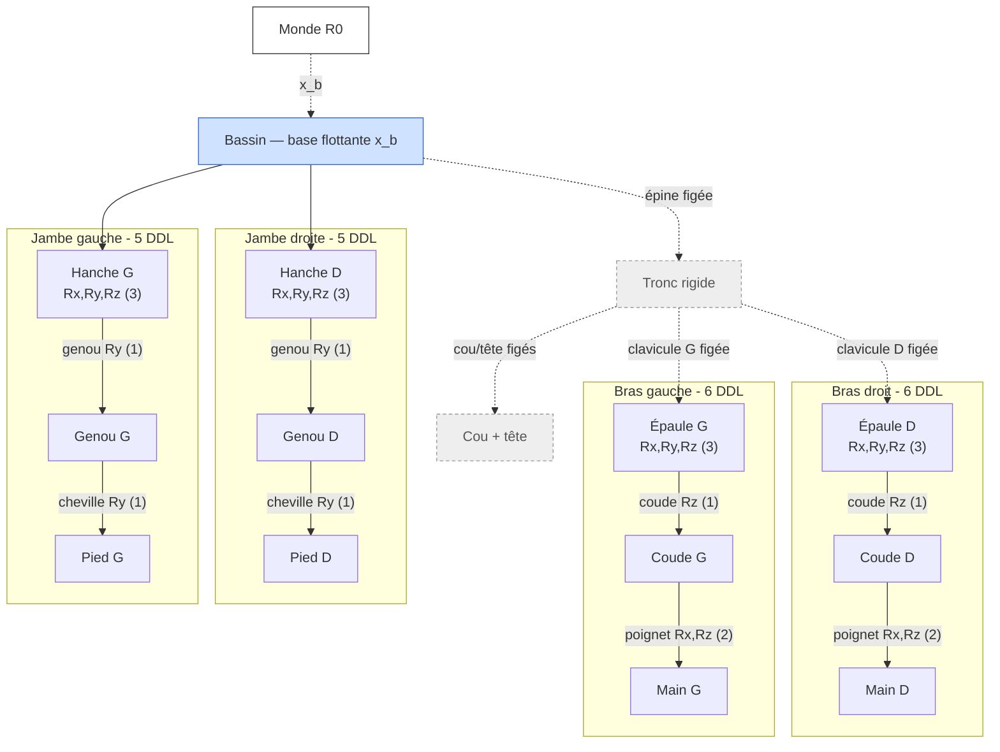
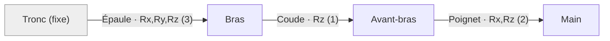

# Formulation cinématique mathématique du mannequin

Document de référence pour la **base mathématique formelle** de la cinématique du
mannequin humain (alimente la section 3 du rapport final).

> **Périmètre (consigne Ciampi, 20 mai 2026).** L'objectif est de *structurer et
> expliquer* la cinématique sous forme mathématique — donner une base formelle au
> modèle. Il ne s'agit **pas** de résoudre les équations à la main : la résolution
> (cinématique inverse, intégration temporelle) est faite numériquement par RoboDK
> et les solveurs associés. On pose les équations, on identifie les inconnues, on
> précise la méthode de résolution.

Le document suit l'organisation **socle commun + deux spécialisations** (un par
scénario), car la coexistence sollicite les membres inférieurs (locomotion) et la
synchronisation les membres supérieurs (manipulation).

---

## 1. Notations et conventions

| Symbole | Signification |
|---|---|
| $\mathcal{R}_0$ | Repère monde (fixe, lié à la cellule ALIX) |
| $\mathcal{R}_b$ | Repère base, lié au bassin (pelvis) |
| $\mathcal{R}_i$ | Repère attaché au corps (link) $i$ |
| $q_i$ | Variable articulaire du degré de liberté $i$ (angle, en rad) |
| $\mathbf{q} \in \mathbb{R}^{n}$ | Vecteur des variables articulaires, $n = 22$ |
| ${}^{a}\mathbf{T}_{b}$ | Transformation homogène du repère $b$ exprimée dans $a$ |
| ${}^{a}\mathbf{R}_{b}$, ${}^{a}\mathbf{p}_{b}$ | Rotation et translation associées |

Une transformation homogène appartient à $SE(3)$ :

$$
{}^{a}\mathbf{T}_{b} =
\begin{bmatrix} {}^{a}\mathbf{R}_{b} & {}^{a}\mathbf{p}_{b} \\ \mathbf{0}^{\top} & 1 \end{bmatrix},
\qquad {}^{a}\mathbf{R}_{b} \in SO(3),\ {}^{a}\mathbf{p}_{b} \in \mathbb{R}^{3}.
$$

Les rotations élémentaires autour des axes canoniques :

$$
\mathbf{R}_x(\theta)=\begin{bmatrix}1&0&0\\0&\cos\theta&-\sin\theta\\0&\sin\theta&\cos\theta\end{bmatrix},\
\mathbf{R}_y(\theta)=\begin{bmatrix}\cos\theta&0&\sin\theta\\0&1&0\\-\sin\theta&0&\cos\theta\end{bmatrix},\
\mathbf{R}_z(\theta)=\begin{bmatrix}\cos\theta&-\sin\theta&0\\\sin\theta&\cos\theta&0\\0&0&1\end{bmatrix}.
$$

**Convention retenue : transformations homogènes successives (style URDF), pas
Denavit–Hartenberg.** Le DH classique suppose une chaîne **série** ; or notre
mannequin est un arbre **ramifié** (bassin → 2 bras + 2 jambes). On exprime donc
chaque liaison directement à partir de son décalage fixe et de son axe de rotation,
comme dans le fichier URDF (`Niko_v2_PRBE.urdf`).

---

## 2. Brique élémentaire : la liaison articulaire

Chaque degré de liberté est une **liaison pivot mono-axe**. Dans l'URDF, une
articulation à plusieurs axes (épaule, hanche) est décomposée en pivots successifs
reliés par des links intermédiaires de masse négligeable (`_f1`, `_f2`). La
transformation du repère enfant $i$ par rapport à son parent $p(i)$ s'écrit :

$$
{}^{p(i)}\mathbf{T}_{i}(q_i) = \mathbf{T}_{\text{off},i}\cdot \mathbf{R}_{u_i}(q_i),
$$

où :
- $\mathbf{T}_{\text{off},i}$ est le décalage fixe parent→enfant (champ `<origin>` de l'URDF, constant) ;
- $\mathbf{R}_{u_i}(q_i)$ est la rotation d'angle $q_i$ autour de l'axe $u_i \in \{x,y,z\}$ de la liaison (champ `<axis>`).

La décomposition mono-axe **fige l'ordre des rotations** : c'est une contrainte à
respecter dans toute la formulation (et dans l'IK).

---

## 3. Cinématique directe du mannequin (socle commun)

Le mannequin est un arbre de corps rigides enraciné au bassin. La pose d'un link
$L$ dans le monde est le **produit des transformations le long de l'unique chemin**
de la base à $L$ :

$$
{}^{0}\mathbf{T}_{L}(\mathbf{q}, \mathbf{x}_b) =
{}^{0}\mathbf{T}_{b}(\mathbf{x}_b)\,
\prod_{i \in \text{chemin}(b \to L)} {}^{p(i)}\mathbf{T}_{i}(q_i).
$$

Chaque membre (bras gauche/droit, jambe gauche/droite) est une **chaîne série
indépendante** issue du bassin ; l'arbre se traite comme quatre chaînes série
partageant la même base.

### Arbre cinématique

Les liaisons en **pointillés gris** sont figées (rigides) ; les flèches pleines
portent les 22 degrés de liberté actifs.

### Base flottante

Le bassin n'est pas ancré au monde : sa pose est paramétrée par
$\mathbf{x}_b = (\mathbf{p}_b, \boldsymbol{\Phi}_b)$ (position + orientation),

$$
{}^{0}\mathbf{T}_{b}(\mathbf{x}_b) =
\begin{bmatrix}\mathbf{R}(\boldsymbol{\Phi}_b) & \mathbf{p}_b \\ \mathbf{0}^\top & 1\end{bmatrix}.
$$

Cette base flottante est **nécessaire au scénario 1** (l'opérateur se déplace dans
la cellule). Le choix d'ancrage final (base fixe vs mobile dans RoboDK) sera tranché
à l'import ; la formulation, elle, reste générale.

### Vecteur d'état

$$
\mathbf{q} = \big[\underbrace{q_1,\dots,q_6}_{\text{bras D}},\ \underbrace{q_7,\dots,q_{12}}_{\text{bras G}},\ \underbrace{q_{13},\dots,q_{17}}_{\text{jambe D}},\ \underbrace{q_{18},\dots,q_{22}}_{\text{jambe G}}\big]^{\top}\in\mathbb{R}^{22}.
$$

---

## 4. Scénario 1 — Coexistence (membres inférieurs, locomotion)

Enjeu : **sécurité**. L'opérateur se déplace, le robot adapte sa vitesse selon la
proximité. La cinématique pertinente est celle des **jambes + base**.

### 4.1 Chaîne cinématique d'une jambe (5 DDL)

Bassin → hanche (3 DDL) → genou (1 DDL) → cheville (1 DDL) → pied. Avec les axes
réels du modèle (jambe droite) :

$$
{}^{b}\mathbf{T}_{\text{pied}}(\mathbf{q}_{\text{jambe}}) =
\underbrace{\mathbf{T}_{o}\mathbf{R}_x(q_{13})\,\mathbf{T}_{o}\mathbf{R}_y(q_{14})\,\mathbf{T}_{o}\mathbf{R}_z(q_{15})}_{\text{hanche (rotule 3 axes)}}\,
\underbrace{\mathbf{T}_{o}\mathbf{R}_y(q_{16})}_{\text{genou}}\,
\underbrace{\mathbf{T}_{o}\mathbf{R}_y(q_{17})}_{\text{cheville}},
$$

où chaque $\mathbf{T}_{o}$ désigne le décalage fixe propre à la liaison. Genou et
cheville sont des pivots autour de $y$ (axe sagittal, flexion) — cohérent avec les
butées articulaires du modèle (genou $\in[0,135°]$, cheville $\in[-30°,+50°]$).

Chaîne de la jambe (segments reliés par leurs liaisons, axes indiqués) :

### 4.2 Modèle de déplacement

La locomotion se décompose en :
- une **trajectoire de la base** dans le plan horizontal,
  $\mathbf{p}_b(t) = (x(t),\,y(t),\,z_0)$, cap $\theta(t)$, soit
  ${}^{0}\mathbf{T}_b(t) = \mathbf{Trans}(x,y,z_0)\,\mathbf{R}_z(\theta)$ ;
- un **cycle de marche simplifié** appliqué aux jambes : $\mathbf{q}_{\text{jambes}}(t)$
  paramétré par une phase de marche $\phi(t)\in[0,2\pi)$ (mouvement cyclique, pas de
  contact dynamique modélisé — hypothèse de simplification validée en réunion).

### 4.3 Couplage cinématique → comportement du robot

La grandeur qui relie la cinématique humaine au comportement du robot est la
**distance de proximité** :

$$
d(t) = \min_{\mathbf{p}_h \in \mathcal{H}(\mathbf{q},\mathbf{x}_b)} \ \min_{\mathbf{p}_r \in \mathcal{B}_{\text{robot}}} \ \lVert \mathbf{p}_h - \mathbf{p}_r \rVert,
$$

où $\mathcal{H}$ est l'ensemble des points du corps humain (issus de la FK) et
$\mathcal{B}_{\text{robot}}$ ceux du robot. La loi de sécurité (distances validées
en réunion) :

$$
v_{\text{robot}}(d) =
\begin{cases}
v_{\max}, & d > d_{\text{ralent}}=1\,\text{m},\\[2pt]
v_{\max}\,\dfrac{d - d_{\text{arret}}}{d_{\text{ralent}} - d_{\text{arret}}}, & d_{\text{arret}} \le d \le d_{\text{ralent}},\\[6pt]
0, & d < d_{\text{arret}}=0{,}5\,\text{m}.
\end{cases}
$$

**Logique de porte (condition temporelle) :** si l'humain est dans la zone de porte
et immobile pendant $T_{\text{att}} = 30\,\text{s}$, le robot recule pour céder le
passage, puis reprend.

---

## 5. Scénario 2 — Synchronisation (membres supérieurs, manipulation)

Enjeu : **efficacité**. Le robot livre/récupère des pièces, l'opérateur assemble.
La cinématique pertinente est celle du **bras** (formulée pour un bras générique —
valable pour les deux par symétrie).

### 5.1 Cinématique directe du bras (6 DDL)

Épaule (3 DDL) → coude (1 DDL) → poignet (2 DDL). Avec les axes réels (bras droit) :

$$
{}^{0}\mathbf{T}_{\text{main}}(\mathbf{q}_{\text{bras}}) =
{}^{0}\mathbf{T}_{\text{épaule}}\,
\underbrace{\mathbf{T}_{o}\mathbf{R}_x(q_1)\mathbf{T}_{o}\mathbf{R}_y(q_2)\mathbf{T}_{o}\mathbf{R}_z(q_3)}_{\text{épaule (rotule 3 axes)}}\,
\underbrace{\mathbf{T}_{o}\mathbf{R}_z(q_4)}_{\text{coude (flexion)}}\,
\underbrace{\mathbf{T}_{o}\mathbf{R}_x(q_5)\mathbf{T}_{o}\mathbf{R}_z(q_6)}_{\text{poignet}}.
$$

La pose de la main s'extrait de ${}^{0}\mathbf{T}_{\text{main}}$ : position
$\mathbf{p}_{\text{main}}\in\mathbb{R}^3$ et orientation ${}^{0}\mathbf{R}_{\text{main}}\in SO(3)$.

Chaîne du bras (segments reliés par leurs liaisons, axes indiqués) :

### 5.2 Problème de cinématique inverse (posé, non résolu à la main)

Atteindre une cible (zone de dépôt) de pose $\mathbf{T}_{\text{cible}}$ revient à
trouver $\mathbf{q}_{\text{bras}}$ tel que :

$$
{}^{0}\mathbf{T}_{\text{main}}(\mathbf{q}_{\text{bras}}) = \mathbf{T}_{\text{cible}}.
$$

De façon équivalente, on annule une erreur de pose
$\mathbf{e}(\mathbf{q}) = \big[\mathbf{e}_{\text{pos}};\,\mathbf{e}_{\text{ori}}\big]\in\mathbb{R}^6$.
Le système est **non linéaire** ; on le résout numériquement à l'aide de la
**Jacobienne** $\mathbf{J}(\mathbf{q}) = \partial \mathbf{x}_{\text{main}}/\partial \mathbf{q} \in \mathbb{R}^{6\times 6}$,
par itération (Newton / moindres carrés amortis) :

$$
\mathbf{q}_{k+1} = \mathbf{q}_k + \mathbf{J}^{\dagger}(\mathbf{q}_k)\,\mathbf{e}(\mathbf{q}_k),
\qquad
\mathbf{J}^{\dagger} = \mathbf{J}^{\top}\big(\mathbf{J}\mathbf{J}^{\top} + \lambda^2 \mathbf{I}\big)^{-1},
$$

avec $\lambda$ le facteur d'amortissement (gère les singularités). **Cette résolution
est assurée par RoboDK (ou `ikpy`/`pinocchio`)** — on en pose ici la structure.

> *Remarque :* le bras a 6 DDL pour une cible 6D (position + orientation) : la
> réalisabilité de poses pleines est marginale (proche des limites de l'espace de
> travail). En pratique on vise la position + une orientation partielle de la main.

### 5.3 Coordination temporelle

Ciampi a insisté : la synchronisation est une **dynamique temporelle coordonnée**,
pas un découpage séquentiel des tâches. On la formalise par une ligne de temps :
- $t_d$ : instant de dépôt d'un lot par le robot ;
- $\tau_a$ : durée d'assemblage par l'opérateur ;
- $\tau_r$ : durée de récupération/retour par le robot.

Contrainte d'encombrement : au plus **2 lots** dans la zone (1 en assemblage + 1 en
attente). L'état de la zone $s(t)\in\{\text{libre, occupée, saturée}\}$ pilote
l'attente du robot. L'objectif est de **minimiser le temps d'inactivité** de
l'opérateur en recouvrant assemblage et livraison :

$$
\min \ T_{\text{idle}} = \sum_k \big(t^{\text{début}}_{a,k} - t^{\text{dispo}}_{k}\big),
\quad \text{s.c. } s(t) \neq \text{saturée}.
$$

---

## 6. Hypothèses et limites

- **Corps rigides** : segments indéformables, pas de tissu mou ni de muscles actifs.
- **Liaisons mono-axe** à ordre de rotation figé (décomposition URDF).
- **Segments figés** : épine, cou, tête, clavicules, doigts (non critiques pour les
  scénarios) — réduisent l'arbre à 22 DDL pilotables.
- **Locomotion simplifiée** : cycle de marche cinématique, sans contact ni équilibre
  dynamique (pas de ZMP).
- **Résolution déléguée** : FK calculée analytiquement ; IK et intégration
  temporelle résolues numériquement (RoboDK / solveurs), conformément à la consigne.

---

## 7. Lien avec l'implémentation

- Modèle : [`examples/Niko_v2_PRBE.urdf`](../examples/Niko_v2_PRBE.urdf) (22 DDL,
  axes et butées repris ci-dessus).
- Méthodes FK/IK : voir [`docs/etat-de-l-art.md`](etat-de-l-art.md) (FK, IK, mocap).
- Import et pilotage : voir [`docs/import-robodk.md`](import-robodk.md).
- Distances et conditions de sécurité (scénario 1) :
  [`docs/distances-conditions-securite.md`](distances-conditions-securite.md).
