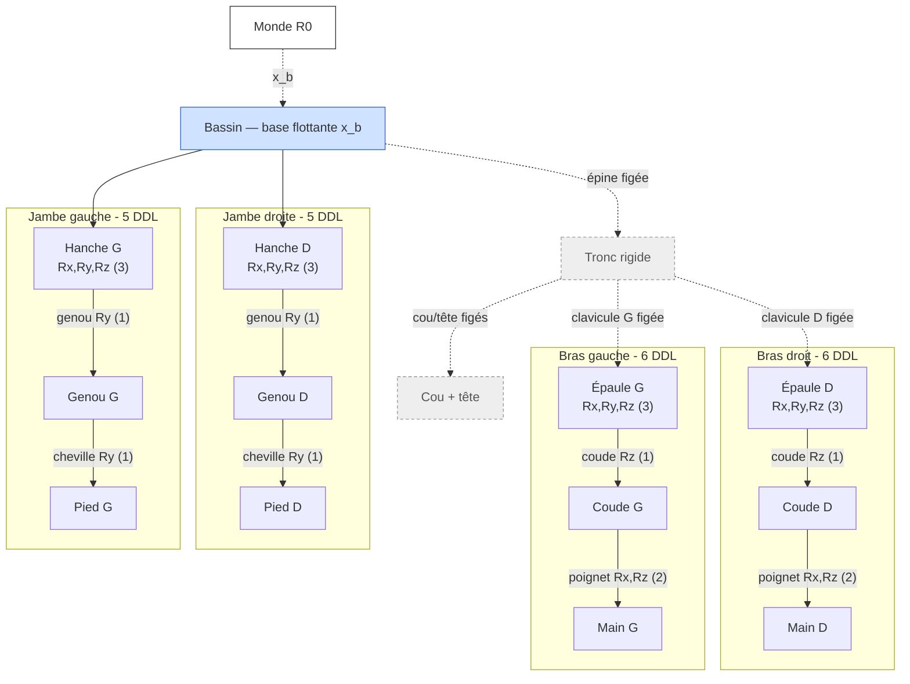
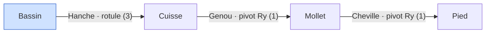
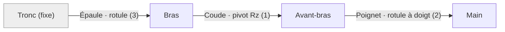

# Formulation cinématique mathématique du mannequin

Document de référence pour la **base mathématique formelle** de la cinématique du
mannequin humain (alimente la section 3 du rapport final).

> **Périmètre (consigne Ciampi, 20 mai 2026).** On *structure et explique* la
> cinématique — on donne une base formelle au modèle. On **ne résout pas** les
> équations à la main : l'inversion et l'intégration temporelle sont faites
> numériquement (RoboDK / solveurs). On pose les équations, on identifie les
> inconnues, on précise la méthode.

**Formalisme retenu : le torseur cinématique.** C'est l'outil mécanique qui décrit
directement *comment un solide bouge par rapport à un autre*. Son intérêt ici : on
**lit les degrés de liberté sur le torseur** (les composantes non nulles = mouvements
permis), et il **se compose par une simple somme** le long d'une chaîne. Les
transformations homogènes ne servent qu'à la **position** (où sont les segments).

---

## 1. Deux questions, deux outils

| Question | Outil | Objet |
|---|---|---|
| **Où** sont les segments ? | Transformation homogène ${}^{a}\mathbf{T}_{b}\in SE(3)$ | position + orientation |
| **Comment** ça bouge / quels DDL ? | **Torseur cinématique** $\{\mathcal{V}_{S/R}\}$ | vitesses permises |

On traite d'abord brièvement la position (section 3), puis on développe le mouvement
au moyen des torseurs (sections 4 à 6), avant de spécialiser par scénario (7 et 8).

---

## 2. Le torseur cinématique

Le mouvement d'un solide $S$ par rapport à un repère $R$ est entièrement décrit par
son **torseur cinématique**, réduit en un point $A$ :

$$
\{\mathcal{V}_{S/R}\}_A =
\left\{
\begin{array}{c}
\vec{\Omega}_{S/R} \\[2pt]
\vec{V}_{A\in S/R}
\end{array}
\right\}
=
\begin{Bmatrix} p & u \\ q & v \\ r & w \end{Bmatrix}_{A,\,\mathcal{B}}
$$

- $\vec{\Omega}_{S/R} = p\,\vec{x} + q\,\vec{y} + r\,\vec{z}$ : **vecteur rotation** (résultante du torseur) ;
- $\vec{V}_{A\in S/R} = u\,\vec{x} + v\,\vec{y} + w\,\vec{z}$ : **vitesse du point $A$** de $S$ par rapport à $R$ (moment du torseur en $A$).

**Transport en un autre point $B$** (la même information, lue ailleurs) :

$$
\vec{V}_{B\in S/R} = \vec{V}_{A\in S/R} + \vec{\Omega}_{S/R}\wedge\vec{AB}.
$$

**Comment lire un torseur :** chaque composante non nulle est un **degré de liberté**
laissé libre par la liaison ; chaque zéro est un mouvement bloqué. C'est cette lecture
directe qui rend le formalisme parlant.

---

## 3. Position des segments (couche position)

Pour situer un segment dans l'espace, on utilise les transformations homogènes :

$$
{}^{a}\mathbf{T}_{b}=\begin{bmatrix}{}^{a}\mathbf{R}_{b} & {}^{a}\mathbf{p}_{b}\\ \mathbf{0}^{\top} & 1\end{bmatrix},\qquad
{}^{p(i)}\mathbf{T}_{i}(q_i)=\mathbf{T}_{\text{off},i}\,\mathbf{R}_{u_i}(q_i),
$$

où $\mathbf{T}_{\text{off},i}$ est le décalage fixe parent→enfant (champ `<origin>` de
l'URDF) et $\mathbf{R}_{u_i}(q_i)$ la rotation d'angle $q_i$ autour de l'axe
$u_i\in\{x,y,z\}$ de la liaison. La pose d'un segment $L$ est le produit le long de
l'unique chemin de la base à $L$ :

$$
{}^{0}\mathbf{T}_{L}(\mathbf{q},\mathbf{x}_b)=
{}^{0}\mathbf{T}_{b}(\mathbf{x}_b)\prod_{i\in\text{chemin}(b\to L)}{}^{p(i)}\mathbf{T}_{i}(q_i).
$$

> **Convention : transformations successives style URDF, pas Denavit–Hartenberg** —
> le DH suppose une chaîne série, or le mannequin est un arbre **ramifié** (bassin →
> 2 bras + 2 jambes), traité comme quatre chaînes série partageant la même base.

### Arbre cinématique

Les liaisons en **pointillés gris** sont figées (rigides) ; les flèches pleines
portent les 22 degrés de liberté actifs.

### Schéma cinématique normalisé (liaisons)

L'arbre ci-dessus reflète la **décomposition de calcul** (URDF) : chaque rotule y
apparaît comme trois pivots mono-axe successifs. Le **schéma cinématique normalisé**
(NF EN ISO 3952), lui, représente chaque articulation par sa **liaison** : la rotule
(3 rotations) n'est qu'**un seul symbole**, pas trois pivots.

| Articulation | Liaison normalisée | DDL |
|---|---|---|
| Épaule, Hanche | **Rotule (sphérique)** | 3 rotations |
| Coude, Genou, Cheville | **Pivot** | 1 rotation |
| Poignet | **Rotule à doigt (sphérique à doigt)** | 2 rotations |
| Épine, cou, tête, clavicules, doigts | **Encastrement** | 0 (solide rigide) |

> Le tronc (épine + cou + tête + clavicules encastrés) forme **un seul solide
> rigide**. La décomposition en pivots de l'URDF reste l'outil de calcul ; le schéma
> de liaisons est la représentation mécanique formelle attendue au rapport.

### Base flottante et vecteur d'état

Le bassin n'est pas ancré : sa pose est $\mathbf{x}_b=(\mathbf{p}_b,\boldsymbol{\Phi}_b)$
(nécessaire au scénario 1, où l'opérateur se déplace). Les variables articulaires :

$$
\mathbf{q}=\big[\underbrace{q_1,\dots,q_6}_{\text{bras D}},\underbrace{q_7,\dots,q_{12}}_{\text{bras G}},\underbrace{q_{13},\dots,q_{17}}_{\text{jambe D}},\underbrace{q_{18},\dots,q_{22}}_{\text{jambe G}}\big]^{\top}\in\mathbb{R}^{22}.
$$

---

## 4. Torseur de chaque liaison

C'est le lien direct avec le schéma de liaisons : à chaque liaison correspond un
torseur cinématique caractéristique, qui **liste ses mouvements permis**.

**Pivot** d'axe $(A,\vec{u})$ — 1 DDL (1 rotation) :

$$
\{\mathcal{V}\}_A=\begin{Bmatrix}0 & 0\\ 0 & 0\\ \dot q & 0\end{Bmatrix}_{A,\,\mathcal{B}}
\quad(\vec{u}=\vec{z}),\qquad \vec{V}_A=\vec 0 .
$$

**Rotule (sphérique)** de centre $A$ — 3 DDL (3 rotations) :

$$
\{\mathcal{V}\}_A=\begin{Bmatrix}\omega_x & 0\\ \omega_y & 0\\ \omega_z & 0\end{Bmatrix}_A,\qquad \vec{V}_A=\vec 0 .
$$

**Rotule à doigt** de centre $A$, doigt bloquant la rotation autour de $\vec{z}$ —
2 DDL (2 rotations) :

$$
\{\mathcal{V}\}_A=\begin{Bmatrix}\omega_x & 0\\ \omega_y & 0\\ 0 & 0\end{Bmatrix}_A .
$$

**Encastrement** — 0 DDL : torseur nul $\{\mathcal{V}\}=\{\,0\,\}$ (les segments figés
forment un seul solide).

Correspondance avec le mannequin : épaule/hanche → torseur de **rotule** ;
coude/genou/cheville → torseur de **pivot** ; poignet → torseur de **rotule à doigt** ;
tronc (épine, cou, tête, clavicules) → **encastrement**. On retrouve $2(3)+2(1)+2(2)$
pour les bras et $2(3+1+1)$ pour les jambes, soit **22 DDL**.

---

## 5. Composition cinématique le long d'une chaîne

Le mouvement d'un membre s'obtient en **additionnant les torseurs** des liaisons
successives (réduits au même point) — c'est la composition des mouvements :

$$
\{\mathcal{V}_{n/0}\}=\sum_{i=1}^{n}\{\mathcal{V}_{i/i-1}\},
\qquad\text{en particulier}\qquad
\vec{\Omega}_{n/0}=\sum_{i=1}^{n}\vec{\Omega}_{i/i-1}.
$$

Réduits au point d'extrémité $H$ (la main, le pied…), les torseurs unitaires de chaque
liaison donnent directement la **Jacobienne** :

$$
\{\mathcal{V}_{H/0}\}_H=\sum_i \dot q_i\,\{\mathcal{T}_i\}_H
\;\;\Longleftrightarrow\;\;
\begin{bmatrix}\vec{\Omega}_{H/0}\\[2pt]\vec{V}_{H/0}\end{bmatrix}=\mathbf{J}(\mathbf{q})\,\dot{\mathbf{q}}.
$$

**À retenir :** chaque **colonne de $\mathbf{J}$ est le torseur unitaire d'une liaison**
ramené à $H$. La Jacobienne n'est donc pas un objet abstrait : c'est l'empilement des
mouvements élémentaires permis par chaque articulation.

---

## 6. Scénario 1 — Coexistence (membres inférieurs, locomotion)

Enjeu : **sécurité**. L'opérateur se déplace, le robot adapte sa vitesse selon la
proximité.

**Torseur du corps.** La marche se modélise par le torseur du bassin par rapport au
sol, $\{\mathcal{V}_{b/0}\}$ (translation dans le plan + cap), composé avec les
torseurs de pivot du cycle de jambes (phase $\phi(t)$). La vitesse d'un point $M$ du
corps se lit par transport :

$$
\vec{V}_{M\in\text{corps}/0}=\vec{V}_{b/0}+\vec{\Omega}_{\text{corps}/0}\wedge\vec{bM}.
$$

**Couplage avec la sécurité.** Deux grandeurs cinématiques pilotent le robot :
- la **distance de proximité** $\displaystyle d(t)=\min_{\mathbf{p}_h\in\mathcal{H}}\min_{\mathbf{p}_r\in\mathcal{B}_\text{robot}}\lVert\mathbf{p}_h-\mathbf{p}_r\rVert$ (issue de la position) ;
- la **vitesse de rapprochement** $v_{\text{rel}}=(\vec{V}_{M/0}-\vec{V}_{\text{robot}/0})\cdot\vec{n}$ le long de la direction de séparation $\vec{n}$ (issue du torseur).

La loi de ralentissement/arrêt (distances validées en réunion) :

$$
v_{\text{robot}}(d)=
\begin{cases}
v_{\max}, & d>d_{\text{ralent}}=1\,\text{m},\\[2pt]
v_{\max}\,\dfrac{d-d_{\text{arret}}}{d_{\text{ralent}}-d_{\text{arret}}}, & d_{\text{arret}}\le d\le d_{\text{ralent}},\\[6pt]
0, & d<d_{\text{arret}}=0{,}5\,\text{m}.
\end{cases}
$$

La vitesse de rapprochement $v_{\text{rel}}$ alimente la distance de séparation
protectrice du *Speed and Separation Monitoring* (ISO/TS 15066) : plus l'humain se
rapproche vite, plus la marge requise est grande — la cinématique (torseur) nourrit
donc directement la règle de sécurité.

**Logique de porte :** si l'humain est immobile dans la zone de porte pendant
$T_{\text{att}}=30\,\text{s}$, le robot recule pour céder le passage, puis reprend.

---

## 7. Scénario 2 — Synchronisation (membres supérieurs, manipulation)

Enjeu : **efficacité**. Le robot livre/récupère des pièces, l'opérateur assemble.
Chaîne formulée pour un bras générique (valable pour les deux par symétrie).

**Torseur de la main.** Par composition (section 5), le mouvement de la main par
rapport au tronc est la somme des torseurs des trois liaisons du bras :

$$
\{\mathcal{V}_{\text{main}/\text{tronc}}\}=
\{\mathcal{V}_{\text{rotule épaule}}\}+\{\mathcal{V}_{\text{pivot coude}}\}+\{\mathcal{V}_{\text{rotule à doigt poignet}}\}.
$$

Réduit à la main $H$, cela donne $\vec{V}_{H}$ et $\vec{\Omega}_{\text{main}}$ en
fonction des vitesses articulaires $\dot{\mathbf{q}}_{\text{bras}}$ : c'est la relation
$\{\mathcal{V}\}=\mathbf{J}(\mathbf{q})\,\dot{\mathbf{q}}$ de la section 5, avec
$\mathbf{J}\in\mathbb{R}^{6\times 6}$ (6 DDL : 3 + 1 + 2).

**Cinématique inverse (posée, non résolue à la main).** Atteindre la zone de dépôt de
pose $\mathbf{T}_{\text{cible}}$ revient à trouver $\mathbf{q}_{\text{bras}}$ tel que
${}^{0}\mathbf{T}_{\text{main}}(\mathbf{q}_{\text{bras}})=\mathbf{T}_{\text{cible}}$. On
annule l'erreur de pose $\mathbf{e}(\mathbf{q})\in\mathbb{R}^6$ par itération, en
exploitant la Jacobienne issue des torseurs :

$$
\dot{\mathbf{q}}=\mathbf{J}^{\dagger}\,\dot{\mathbf{x}}_{\text{désirée}},\qquad
\mathbf{J}^{\dagger}=\mathbf{J}^{\top}\big(\mathbf{J}\mathbf{J}^{\top}+\lambda^2\mathbf{I}\big)^{-1},
$$

avec $\lambda$ l'amortissement (gère les singularités). **Résolution assurée par
RoboDK** (ou `ikpy`/`pinocchio`) — on en pose ici la structure.

> *Remarque :* 6 DDL pour une cible 6D → réalisabilité de poses pleines marginale (bords
> de l'espace de travail) ; en pratique on vise la position + une orientation partielle.

**Coordination temporelle.** La synchronisation est une dynamique temporelle
coordonnée (Ciampi), pas un découpage séquentiel. Ligne de temps : dépôt robot $t_d$,
assemblage opérateur $\tau_a$, récupération $\tau_r$ ; au plus **2 lots** dans la zone
(état $s(t)\in\{\text{libre, occupée, saturée}\}$). Objectif :

$$
\min\ T_{\text{idle}}=\sum_k\big(t^{\text{début}}_{a,k}-t^{\text{dispo}}_{k}\big),
\quad\text{s.c. } s(t)\neq\text{saturée}.
$$

---

## 8. Hypothèses et limites

- **Corps rigides** : segments indéformables, pas de tissu mou ni de muscles actifs.
- **Liaisons** : rotule (épaule, hanche), pivot (coude, genou, cheville), rotule à
  doigt (poignet), encastrement (tronc) — décomposées en pivots mono-axe à ordre figé
  pour le calcul URDF.
- **Locomotion simplifiée** : cycle de marche cinématique, sans contact ni équilibre
  dynamique (pas de ZMP).
- **Résolution déléguée** : position (FK) et torseurs calculés analytiquement ;
  inversion (IK) et intégration temporelle résolues numériquement (RoboDK), conformément
  à la consigne.

---

## 9. Lien avec l'implémentation

- Modèle : [`examples/Niko_v2_PRBE.urdf`](../examples/Niko_v2_PRBE.urdf) (22 DDL, axes et butées).
- Méthodes FK/IK : voir [`docs/etat-de-l-art.md`](etat-de-l-art.md).
- Import et pilotage : voir [`docs/import-robodk.md`](import-robodk.md).
- Distances et conditions de sécurité (scénario 1) : [`docs/distances-conditions-securite.md`](distances-conditions-securite.md).
